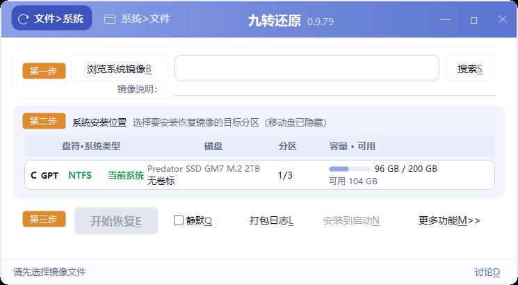
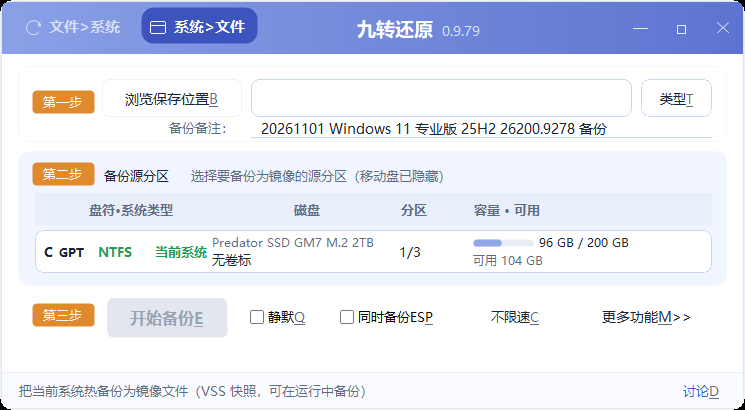

# NineRestore (九转还原)

> One-click Windows system backup and restore.  
> **English** | [中文](README.md)

[](https://github.com/WooMonlee/NineRestore/releases/latest)

**No separate WinPE media · built-in rescue environment · BIOS/MBR and UEFI/GPT · Secure Boot ready · ESP backup · roll back to the pre-restore system · Chinese/English UI**





---

## What it is

NineRestore is a portable Windows system backup and restore tool.

It packages the running system drive into a single image file (WIM / ESD). When Windows is broken,
infected, or a major update fails, you do not need to reinstall or hunt for a WinPE drive:
pick the image and the target partition, press Start, and the system is put back to the state it had
when the image was taken.

A small Linux rescue environment is built into the package. When a restore needs a reboot, the
program stages the task and boots into that rescue environment automatically. You can also install
the rescue environment into the firmware boot menu as a fallback entry for machines that can no
longer boot Windows.

### What problems it solves

- **Self-recovery without another PC.** The image and the rescue environment are both local;
  no network and no second computer are required.
- **No WinPE skills needed.** The normal path is “pick an image → pick a partition → Start”.
- **A way back after changing systems.** The old system is kept for a while by default; if the new
  system does not boot, you can roll back.
- **Secure Boot machines need no BIOS changes.** The chain is Microsoft-signed; no need to disable
  Secure Boot and no key enrollment.
- **Servers and RAID machines can see their disks.** The rescue layer ships a full Linux storage and
  filesystem driver set instead of relying on the limited drivers inside a PE.

---

## Who it is for

- Home users who want a “system image they can go back to”.
- Repair shops and system maintainers who need fast, repeatable restores.
- IT administrators who need batch backup, scripted restores, and dissimilar-hardware deployment.

---

## Supported systems and boot modes

| Item | Support |
|---|---|
| Windows | Windows 7 SP1 and later (Windows 7 needs UCRT, which is bundled) |
| Not supported | Windows Vista / 2003 / XP and earlier |
| Architecture | 64-bit Windows: `SysRecoverUI.exe`; 32-bit Windows: `SysRecoverUI_x86.exe` |
| Rescue environment | 64-bit only (x86_64). The 32-bit Windows entry handles the Windows-side work only; a reboot into the rescue layer requires an x86_64-capable CPU (true for the vast majority of machines) |
| BIOS / MBR | Supported |
| UEFI / GPT | Supported |
| Secure Boot | Supported (CA2011 / CA2023 chain), on or off |
| PE environment | Supported for in-place restore (no reboot when the target is not in use) |
| Image formats | WIM, ESD, and this product's encrypted `.zje` |
| Not supported | ReFS, GHOST / SNA / TBI and other image formats |

> Keep the image on a **locally accessible partition** (for example an NTFS data drive). The rescue
> environment loads no network drivers and cannot read network shares; it also has no ReFS driver,
> so an image stored on ReFS cannot be read during a reboot restore. Do not put images larger than
> 4 GB on FAT32.

---

## How to use it

### 1. Install / upgrade (overwrite the old folder)

1. Download a release package (see “Download” below).
2. Close the running program.
3. Extract the new package **over the old folder**. The program is portable: there is no installer,
   no uninstall step, and no setup wizard.
4. If you added your own drivers under `Drivers\`, keep that folder when overwriting.

> Prefer a partition that will **not** be overwritten by the restore (for example D: or a USB drive),
> not the C: drive you are about to restore. The program can run from the target partition, but
> “return to the old system” will refuse in that case: returning swaps the whole target partition
> and would delete the program itself. The program will ask you to copy it elsewhere first.

### 2. Install to the boot menu (fallback entry)

Useful when Windows can no longer start but you still have a working image.

1. Open the program and select the image.
2. Select the system partition (usually C:) in the partition list.
3. Click **Install to boot** and confirm.
4. On the next boot, enter the rescue menu:
   - **BIOS machines:** press **Up / Down repeatedly** during POST and select `NineRestore`.
   - **UEFI machines:** press the firmware boot hotkey (the UI shows a hint; common keys are
     F12 / F10 / F2 / Esc) and select `NineRestore` from the boot-device list.
5. After selection, the rescue layer restores using the **image + target partition bound at install
   time**; you do not select the image again. Progress is shown on screen; follow any confirmation
   prompt.

> **The bound image must not be moved, renamed, or deleted**, or this menu cannot restore.
> To change the image or remove the menu, use **More >> → Remove recovery boot menu**, or click
> **Install to boot** again to rebind.
>
> The menu is only an entry you choose when needed. A normal boot will not stop in the rescue
> environment. Hotkeys differ by vendor; use the hint shown by the program, or enter the firmware
> boot menu and select `NineRestore`.
>
> Once this permanent menu is installed, a daily **Restore** stops first and asks you to clear the
> menu, so it does not overwrite the permanent entry. This is a deliberate guard, not a failure.

### 3. Restore a system

1. Open the program and select the image.
2. Select the target partition. The “disk / partition” numbers in the list are **physical order**;
   the recommended row is chosen by partition contents (normally the current system drive).
3. Click **Start** and confirm in the dialog.
4. The program decides the path automatically:
   - **Target is the running system drive:** the task is staged, the machine reboots into the
     built-in rescue environment, the image is applied, boot files are repaired, and the machine
     reboots into the new system;
   - **Target is not in use** (inside PE, or a non-system disk): restore in place, no reboot.
5. The confirmation dialog (when a reboot is required) offers **Cancel / Restore then reboot /
   Reboot then restore**:
   - **“Restore then reboot” (default; Enter)** — the old system is moved to `~old` and kept, so
     you can still “return to the old system” after the new system boots. This needs extra disk
     space; the button is greyed out when space is insufficient.
   - **“Reboot then restore”** — do not keep the old system; format the target and restore.
     **All previous contents are discarded.** Choose it only when you are sure you do not need a
     rollback.
   - **“Cancel”** — do nothing.
   - For an in-place restore (no reboot): “Format target partition” is checked by default; uncheck
     it to keep the filesystem and only wipe the contents. “Keep the old system” is unchecked by
     default and can be checked manually (disabled when space is insufficient).

> When restoring the running system drive, save your work and close other programs first.
> The confirmation dialog explains what will happen next.
>
> If this machine has the persistent “Install menu” entry installed, a daily restore stops first
> and asks you to clear that menu, so it does not overwrite the persistent entry. Follow the
> prompt, then restore again.

### 4. The three-choice rescue screen

This screen does **not** appear on every boot. It appears only when the previous restore stopped
halfway and was not confirmed complete — the condition is that the old-system backup `~old` is still
on disk (an unfinished `~new` may also be present):

```
[1] Roll back to the old system (recommended; discards the new one)
[2] Retry the new system
[3] Reboot only
```

- **[1] Roll back:** swap `~old` back to the root and discard the new system. You must type `YES`
  in capitals within 60 seconds, so it cannot be triggered accidentally.
- **[2] Retry:** continue the unfinished restore task.
- **[3] Reboot only:** change nothing and reboot into Windows.

After 120 seconds without input: `[2]` is chosen when a task can be resumed, otherwise `[3]`.
**Unattended runs never roll back automatically.** If you do not see this screen, there is no
unconfirmed task and the rescue layer simply reboots into Windows.

---

## Upgrading from 0.9.x

**Overwrite the installation; there is no need to uninstall first.**

- 1.0 is still a portable program: close the old version and copy the 1.0 files over the old folder.
- If the old version installed a boot menu, **there is no need to remove it first**.
  - **BIOS/MBR:** on first launch, the program detects the legacy `menu.lst` and automatically
    upgrades its title, kernel command line, and rescue payload to the current build.
  - **UEFI:** the old rescue payload on the ESP is replaced the next time you click **Install to
    boot**, or the next time a restore is staged. Until then the old menu still works (it boots the
    old rescue layer); overwriting the program folder does not break it.
- Running **Install to boot** once in 1.0 makes the program recognize the old entry, reuse it, and
  remove duplicate entries of the same kind, so the firmware shows the single name `NineRestore`.
  Skipping this step does not break restores; the old entry may simply keep its old name.
- Existing configuration directories (`%LOCALAPPDATA%\SysRecover`, `%ProgramData%\SysRecover`) are
  reused, not reset.
- **Make a working system image before upgrading.** No system-level tool should be upgraded without
  a way back.

> The 0.9.x releases and notes remain in the old repository as historical versions:
> <https://github.com/WooMonlee/SysRecover-Windows-System-Restore-Backup>
> 1.0 is a rewrite of the same product; the old repository will not receive 1.0 feature updates.

---

## Known limitations (stated plainly)

These are not “maybe later” items. They are things the current version genuinely cannot do, or
things you need to know before using it:

1. **On BIOS (legacy VGA text mode), the rescue UI does not display Chinese.**
   When the rescue layer detects a VGA text console it automatically prints English / ASCII only,
   and **never shows question marks or white blocks**. Backup, restore, and boot repair are not
   affected. UEFI machines can display the Chinese rescue UI normally.

2. **On BIOS/MBR machines, the boot menu may disappear after a restore.**
   MBR menu files (`grldr`, `grldr.mbr`, `menu.lst`, `ZJRESTORE\`) live in the system-drive root and
   are overwritten when the whole C: partition is replaced. The program writes them back after the
   restore and leaves a “redeploy pending” marker; **the menu is reinstalled the next time you start
   this program**. If you never run it again, click **Install to boot** once manually. On UEFI the
   menu lives in the ESP, which a restore does not touch, so the menu survives.

3. **Release binaries are unsigned.**
   First launch may trigger SmartScreen (“Windows protected your PC”). Choose “More info” → “Run
   anyway”. Verify the file against `SHA256SUMS.txt` after downloading. Some security suites
   (360, Kingsoft, etc.) may also block “write boot entry / format partition” actions; when blocked,
   the program stops with a message instead of continuing silently. Add the program to the trusted
   list and retry; **do not disable your security software just to run it**.

4. **WIM / ESD only** (plus this product's encrypted `.zje`), and the target system volume must be
   NTFS. GHOST, SNA, TBI and other formats cannot be restored directly; ReFS cannot serve as the
   restore target for a Windows boot volume.

5. **The image must be on a locally accessible partition.**
   The rescue layer has no network drivers and cannot read network shares; it also cannot read ReFS.

6. **The rescue environment is 64-bit (x86_64) only.**
   Windows 7 needs the UCRT, which is bundled. Vista / 2003 / XP and earlier are not supported.

7. **An in-place restore with “Format target partition” unchecked (keep the filesystem, wipe
   contents only) can abort.**
   If the target NTFS root cannot be emptied completely, the program stops before writing
   (`wipe-incomplete`) and leaves the target unchanged. This is deliberate: it prevents a
   half-written disk. Checking “Format target partition” avoids this case but rebuilds the
   filesystem.

8. **A failed boot repair is not reported as complete success.**
   When the system is restored but boot files are not repaired, the result is `OK_BOOT_UNFIXED`;
   use **Repair boot** or fix it manually.

9. **Universal restore only covers common drivers.**
   Common storage / input drivers are built in, and more can be injected from `Drivers\`. Server
   RAID controllers and unusual OEM devices may still need manual drivers. OEM drivers are for
   local use only; do not redistribute them.

10. **BitLocker, EFS-encrypted files, and third-party reparse points have not been specifically
    validated.** Decrypt or back them up before operating.

11. **“Return to the old system” is refused when the program itself is on the target partition.**
    Returning swaps the whole target partition and would delete the program. The program asks you
    to move it to another partition, or run it from a USB drive / PE.

12. **The boot-order hand-back for Secure Boot + one-shot restore is fixed in code, but has not
    been re-verified on real hardware yet.**
    If a particular firmware still returns to the rescue screen, use the firmware boot hotkey,
    select `Windows Boot Manager`, and boot Windows; or set the Windows entry first in firmware
    setup. Machines with the permanent menu installed are not affected.

13. **Boot hotkeys differ by vendor.**
    The program shows a hint, but the firmware on your machine is the authority. If the hint does not
    work, use “power off → power on into the firmware boot menu → select `NineRestore`”.

14. **“Return to the old system” is refused across firmware/disk-type mismatches.**
    UEFI boot with an MBR target disk, or BIOS/CSM boot with a GPT target disk, cannot perform the
    return directly; boot in the matching mode first. Normal backup and restore are unaffected.

---

## Reporting a problem

Please include:

1. What you did (backup / restore / install menu / repair boot) and whether the machine is BIOS or UEFI;
2. A photo of the on-screen message;
3. Logs from the `logs\` folder under the program directory; **More features >> → Package log**
   creates a support bundle for you;
4. If you entered the rescue screen, the rescue log and the menu item you selected.

Contact:

- **QQ group: 1128237828**
- **Email: `ms_w@qq.com`**

Both channels are also shown on the rescue first screen and on failure messages.

---

## Download

- **GitHub Releases (the only official release location):**  
  <https://github.com/WooMonlee/NineRestore/releases/latest>
- Any mirror / cloud-drive link is listed in the Release notes when available. **Do not download
  from unofficial reposts.**

A release usually contains:

- **Single-file GUI build**: double-click to open the UI. For scripts / batch files use the
  single-file CLI build, which returns exit codes.
- **Single-file CLI build**: for scripts and batch files.
- **`SHA256SUMS.txt`**: the hash list.
- If you downloaded a folder-build archive, extract and run it. If a `Drivers\` folder is included,
  it holds drivers for universal restore and can be deleted if you do not need that feature.

> Verify `SHA256SUMS.txt` after downloading. Do not run the file if the hash does not match.

---

## License and third-party components

- Original code is open source under the **MIT** license; see [LICENSE](LICENSE).
- The component list, versions, usage, and **full license texts** are in
  [THIRD_PARTY_LICENSES.txt](THIRD_PARTY_LICENSES.txt), which also serves as the component list /
  SBOM rows for this release.
- Main third-party components:
  - **wimlib / libwim**: LGPL-3.0, dynamically linked, DLL shipped, user-replaceable;
  - **GNU Unifont 18.0.01 (rescue console bitmap font)**: SIL OFL 1.1, subsetted with the
    modification declared; source, version, SHA-256, and the full license text are in the Unifont
    section of `THIRD_PARTY_LICENSES.txt`;
  - **Alpine / Debian components** (busybox, musl, ntfs-3g, util-linux, kernel and modules, GRUB,
    shim): distributed under their respective licenses, as **unmodified distribution binaries**;
  - **GRUB4DOS**: GPL-2.0, official binaries only, unmodified.

The product **does not statically link any GPL component and does not modify third-party source
code**; third-party components are treated as separate distributions.

---

## Current version status

- Current release line: **`1.0 RC2`** (internal build `1.0.0.16`).
  Naming rules: [docs/37-版本命名规范.md](docs/37-版本命名规范.md).
- 1.0 is a **rewrite** relative to 0.9.x. The old repository keeps only the 0.9.x history and will
  not receive 1.0 updates.
- Known issues and real-machine checklist:
  [docs/33-已知问题与限制（1.0）.md](docs/33-已知问题与限制（1.0）.md),
  [docs/34-发布门禁总表.md](docs/34-发布门禁总表.md).
- Changelog: [CHANGELOG.md](CHANGELOG.md).

> Before each release the package is rebuilt and the version is checked in four places
> (`version.json` / rescue payload version stamp / initramfs stamp / exe resource). If the version
> in your package does not match the Release notes, trust the Release notes and `SHA256SUMS.txt`,
> and report it to us.

---

## Development and build (ordinary users can skip this)

- Build, release, and license compliance: [docs/06-构建发布与许可合规.md](docs/06-构建发布与许可合规.md)
- Onboarding / architecture: [docs/11-接手指南（读我优先）.md](docs/11-接手指南（读我优先）.md),
  [docs/ARCHITECTURE.md](docs/ARCHITECTURE.md)
- Test matrix and real-machine checklist: [docs/07-测试矩阵与回归记录.md](docs/07-测试矩阵与回归记录.md),
  [docs/35-救援载荷与手动验证清单.md](docs/35-救援载荷与手动验证清单.md)
- Repository migration: [docs/38-GitHub迁移说明（旧仓库与本仓库）.md](docs/38-GitHub迁移说明（旧仓库与本仓库）.md)
- Release / pre-push checklist: [docs/39-发布与推送检查清单.md](docs/39-发布与推送检查清单.md)

---

Thanks to everyone who tested, provided logs, and reported problems.
