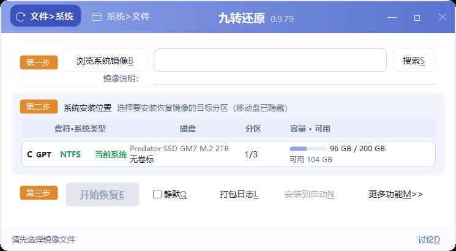
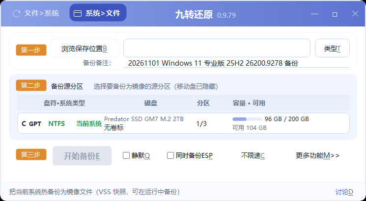

# 九转还原（NineRestore）

> Windows 系统一键备份 / 还原工具  
> **中文** | [English](README.en.md)

[](https://github.com/WooMonlee/SysRecover-Windows-System-Restore-Backup/actions/workflows/ci.yml)
[](https://github.com/WooMonlee/SysRecover-Windows-System-Restore-Backup/releases/latest)

**启动比 WinPE 快 · 支持 Secure Boot CA2011/CA2023 · 可备份 ESP · 可返回安装前的系统 · 可安装启动菜单兜底 · 中英双语 · 完整命令行**

> **下载（单文件版）**：[Releases](https://github.com/WooMonlee/SysRecover-Windows-System-Restore-Backup/releases/latest) →
> `SysRecover-Portable-<版本>.exe`。双击开界面；带参数就是命令行（`... version` / `... list` / `... restore ...`）。





---

## 优点

- **解压目录约 52 MB**（单文件版压缩后更小）；救援层内置，不需要另做 WinPE 启动盘
- 支持 **Secure Boot CA2011 / CA2023**，不用关安全启动，也不用注册密钥
- 可把 **ESP 分区**并入同一镜像，还原系统时自动恢复
- 可选保留旧系统，之后**返回安装前的系统**
- 可安装启动菜单，Windows 进不去时用来**兜底启动**
- 中 / 英双语，支持 **完整命令行**
- 支持 **ESD、WIM**，兼顾体积与兼容性

## 限制

- 系统还原的 **Linux 救援层固定 x86_64**：要求目标机器是 **64 位 CPU**（绝大多数 Win7 以后机器都满足）
- Windows 侧提供 **x64 与 x86 两个入口**：32 位 Windows（Win7 x86 / Win10 x86）用 `*_x86.exe`
- 只支持 **Windows 7 及以后**（Win7 需 UCRT，随包提供）；Vista、2003、XP 及更早版本不支持
- 目前只支持 **ESD / WIM**（以及本产品的加密镜像 `.zje`）
- 发布物**未签名**，首次运行可能触发 SmartScreen；校验与处理见
  [`docs/33-已知问题与限制（1.0）`](docs/33-已知问题与限制（1.0）.md)

---

## 一、已实现

1. **核心使用 wimlib**：Windows 下做热备份和还原，Linux 侧主要做目录交换和修引导；支持 ESD、WIM，以尽可能小的体积实现完整功能。
2. **启动速度比多数 PE 快**：读写盘速度与 PE 相当，支持 **CA2011 / CA2023 双启动链**。
3. **支持全系列命令行参数**，适合批处理、机房和自动化场景。
4. **体积可控**：解压目录约 52 MB；单文件版经压缩后通常更小。
5. **中英双语**。
6. **支持备份 ESP 分区**。
7. **支持安装启动菜单**：
   - BIOS：开机进入 Windows 前连续按上/下键调出选单；
   - UEFI：开机按启动设备快捷键（界面有提示）选择 `SysRecover` 进入还原。
8. **未分区硬盘向导**：新硬盘可以向导式创建 ESP / MSR / 系统分区 / 数据分区。
9. **支持异机还原**：
   - 自带最常用硬件的驱动（约 165MB，位于 `Drivers`）；
   - 无法覆盖所有机型。用户可在自己的电脑上导出驱动，放进 `Drivers` 文件夹，软件会离线注入。
   - 也可以用 Windows 10/11 自带命令自己导出：在目标电脑（或同型号正常机）上以管理员身份打开命令提示符，执行（`D:` 换成 U 盘或数据盘，别放会被还原格式化的分区）：
     ```bat
     mkdir D:\Drivers
     dism /online /export-driver /destination:D:\Drivers
     ```
     或 `pnputil /export-driver * D:\Drivers`。然后把导出的 `Drivers` 文件夹内容合并到程序目录的 `Drivers\`；软件会递归查找其中的 `.inf`。
   - 导出的只是本机第三方驱动，Windows 自带驱动无需导出；目标机已无法启动时，可从同型号正常机导出。OEM 驱动请只在本机使用，不要公开分发。

## 二、架构与位数

1. **Windows 侧双入口**：64 位系统用根目录 `SysRecoverUI.exe`（调用 `x64\SysRecoverUI.exe`）；
   32 位系统用 `SysRecoverUI_x86.exe`（命令行同理，`SysRecover_x86.exe` / `SysRecoverCheck_x86.exe`）。
2. **Linux 救援层固定 x86_64**：不做 32 位救援层（Debian 13 已取消 i386 内核）；
   32 位 Windows 的机器 CPU 也是 64 位，救援层照常启动。
3. 纯 x64 PE（无 WOW64）请直接运行 `x64\SysRecoverUI.exe`；该 PE 若没有 `dism.exe`，异机驱动注入不可用。

## 三、为什么还要再写一个

1. 阵列卡 / 服务器机器上，很多 PE 的驱动认不到 RAID 卡。我们的救援层是完整 Linux 内核 + **494 个存储 / 文件系统模块**。
2. 还得准备 U 盘 / PE 启动盘，多一道工序，也多一个出错的地方。我们的救援层内置在软件里，部署一次，之后一条链走到底。
3. Secure Boot 机器上部分同类工具要进 BIOS 关安全启动。我们走微软签名链，用户不用关，也不用注册任何密钥。
4. 很多工具只能手动做还原，真正不能启动时无法为故障兜底。
5. 一部分工具不能通过命令行全自动还原到不同系统。
6. 绝大多数工具在还原后无法返回安装前的系统。

## 四、命令行用法

全部命令：

```bat
SysRecover.exe help
```

看现场：

```bat
SysRecover.exe list
SysRecover.exe list --include-usb
SysRecover.exe diag --zip
```

- `list`：列磁盘 / 分区 / 盘符 / ESP
- `list --include-usb`：同时列出默认隐藏的 USB 设备（标注「USB 设备」，选择前请确认）
- `diag --zip`：查固件 / Secure Boot / 启动项，并导出诊断包

### 备份当前系统

```bat
SysRecover.exe backup --dest D:\backup\win10.esd --source C: --compress recovery --verify --esp
```

- `--source`：盘符根，`C:` 或 `C:/` 均可
- `--compress`：`recovery`（最小）/ `maximum` / `fast`
- `--verify`：写完立即校验
- `--esp`：把 ESP 分区并入同一镜像，还原时自动恢复回 ESP
- 目标已存在：加 `--yes` 覆盖（与 `--append` 互斥）
- `--append`：追加子镜像（与 `--yes` 互斥）
- `--allow-skipped`：有文件读不到时仍以退出码 0 结束（默认返回 **7 = 备份不完整**）

### 从镜像取单个文件

```bat
SysRecover.exe extract --file D:\backup\win10.esd --index 1 --path "\Users\*\Desktop\*.docx" --dest D:\out
```

- `--path` 可重复，支持通配符，以 `\` 开头

### 还原镜像

```bat
SysRecover.exe list
SysRecover.exe restore --image D:\backup\win10.esd --disk 0 --part 3 --index 1 --yes
```

- `--yes` 必填，确认覆盖目标分区
- `--index N`：指定子镜像，默认 1
- `--no-repair-boot`：不自动修引导（只允许就地还原）
- `--verify-image`：还原前做全量校验（**默认关**；默认只做毫秒级结构预检，跳过时日志会写明"镜像未校验"）
- **是否"重启后再还原"：自动判定**
  - 目标是正在运行的系统盘 → 暂存，重启进救援层自动完成替换和修引导；
  - 目标未被占用（PE 里 / 非系统盘）→ 就地还原，不重启。
- **旧系统保不保留**（仅"重启后还原"路径有效）
  - `--no-keep-old`（**默认**）：新系统首次成功开机后，由首启任务自动清理 `C:\~old`；
    在此之前它一直是可回退的旧系统；
  - `--keep-old`：保留旧系统不动，之后可「返回旧系统」。
- **要不要自动重启**
  - 默认**不自动重启**（脚本/批量更可控），命令行会提示手动重启；
  - `--reboot`：暂存成功后 5 秒自动重启（反悔：`shutdown /a`）。
- 镜像带 ESP 子镜像（备份时 `--esp`）会自动一并恢复
- 镜像必须放在本地分区，救援层访问不到网络

```bat
:: 换系统（默认：新系统首启成功后自动清理 ~old，手动重启）
SysRecover.exe restore --image D:\SYSTEM.WIM --disk 0 --part 3 --yes

:: 换系统（保留旧系统可回退，暂存后自动重启）
SysRecover.exe restore --image D:\SYSTEM.WIM --disk 0 --part 3 --yes --keep-old --reboot
```

> PE 注意：根目录 `SysRecoverUI.exe` 是 **x64 总入口（带图标）**，会调用 `x64\SysRecoverUI.exe`；纯 x64 PE（例如 NewBee 20210523）可以直接运行。32 位 Windows 请用 `SysRecoverUI_x86.exe`。该 PE 没有 `dism.exe`，异机驱动注入不可用，请改用带 DISM 的完整 PE/Windows。

退出码：

```text
0 成功 / 1 通用失败 / 2 参数错 / 3 需管理员 / 4 危险目标被拒 / 5 镜像校验失败 / 6 取消 / 7 备份不完整
```

正常情况下随系统自适应双语。如须指定英文版，运行时加 `--lang en`，或先设置环境变量：

```bat
set SYSRECOVER_LANG=en
```

## 五、下载

- **GitHub Releases（直接下载）**：  
  https://github.com/WooMonlee/SysRecover-Windows-System-Restore-Backup/releases/latest
- **123 云盘**：  
  https://1812167946.share.123pan.cn/123pan/p00rVv-Jb7jH?pwd=8666#  
  提取码：`8666`
- **百度网盘**：  
  https://pan.baidu.com/s/1Ni0TZgKYkBJd8iCEW0qGUQ?pwd=8666  
  提取码：`8666`

> **未签名**：首次运行可能触发 SmartScreen「Windows 已保护你的电脑」，处理方式与 SHA256 校验见
> [`docs/33-已知问题与限制（1.0）`](docs/33-已知问题与限制（1.0）.md)。
>
> 如果嫌体积大，可以直接删除 `Drivers` 目录（约 165MB）。这是为异机还原准备的注入驱动；不使用该功能完全可以删除。

## 六、版本与变更

- 当前版本：**`1.0 beta.2`（内部 `1.0.0.2`）**，详见 [`CHANGELOG.md`](CHANGELOG.md)。
  这一版**未签名**，也**未在实机上跑通完整备份/还原闭环**，请只在不重要的机器或虚拟机里试用。
- 版本策略：测试版 `1.0 beta.N`（文件 `九转大还原1.0-beta.N.exe`，内部 `1.0.0.N`）→ 正式版 `1.0.0`
  （内部 `1.0.0.0`）→ 正式版之后修 bug 走 `1.0.1`、`1.0.2`。完整规则见
  [`docs/37-版本命名规范.md`](docs/37-版本命名规范.md)。
- 界面变化：还原模式第三步的「**异机还原**」是常驻勾选框；「**打包日志**」收进
  「**更多功能>>**」菜单第一项（原为独立按钮）。
- exe 属性（右键 → 属性 → 详细信息）：产品名 `九转还原`、版本 `1.0.0.2`、
  公司 `DreamGrain`、MIT 版权 —— 目录版与单文件版都一致。
- 已知问题与实机待确认项：[`docs/33-已知问题与限制（1.0）`](docs/33-已知问题与限制（1.0）.md)。

## 七、测试与反馈

已在自用台式机、笔记本和 VM 的 **Windows 7 / 10 / 11、BIOS、UEFI、x86、x64** 中测试，但仍需要大家反馈不同电脑、服务器的还原效果。

本项目已以 **MIT** 许可证开源（见 [`LICENSE`](LICENSE)）。还需要什么功能、遇到了什么问题，欢迎提 Issue 或跟帖回复。

- 不便发到论坛的信息，可发送到邮箱：`ms_w@qq.com`
- 更多沟通，请加 QQ 群：**1128237828**

感谢以下坛友反馈使用信息：**公交石头、godworld、tigerhuang、2010ath26810**。

---

## 开发与构建

- 开发/交接：[`docs/11-接手指南（读我优先）`](docs/11-接手指南（读我优先）.md)
- 架构与拆分：[`docs/ARCHITECTURE.md`](docs/ARCHITECTURE.md)
- 构建/发布：[`AGENTS.md`](AGENTS.md)、[`docs/BUILD-REPORT.md`](docs/BUILD-REPORT.md)
- 许可证：自有代码 **MIT**，见 [`LICENSE`](LICENSE)；第三方组件许可见 [`THIRD_PARTY_LICENSES.txt`](THIRD_PARTY_LICENSES.txt)
